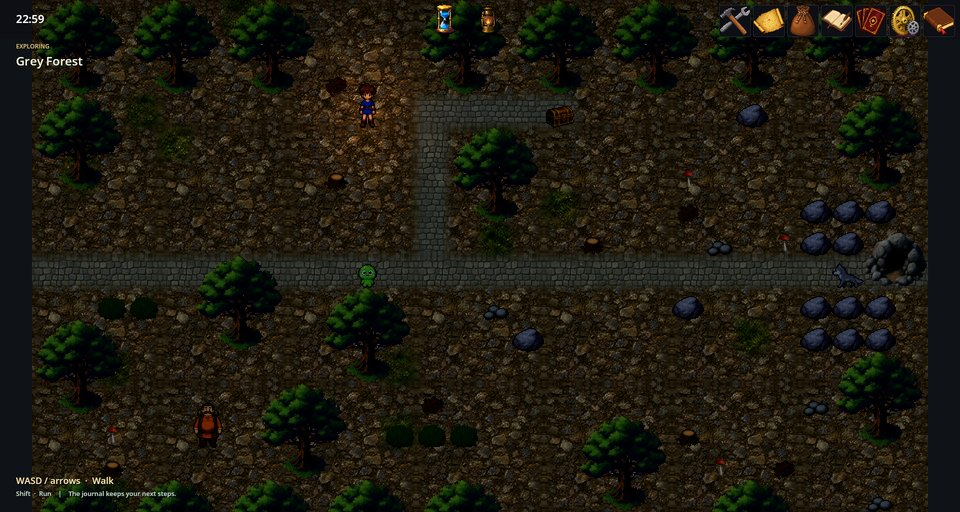
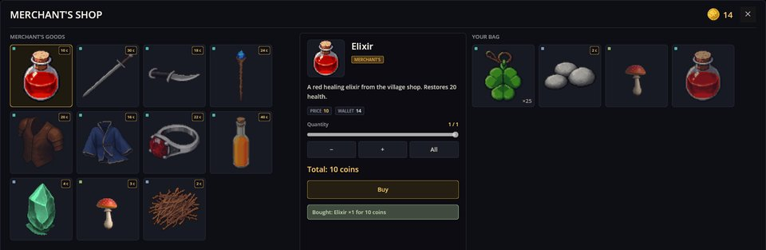
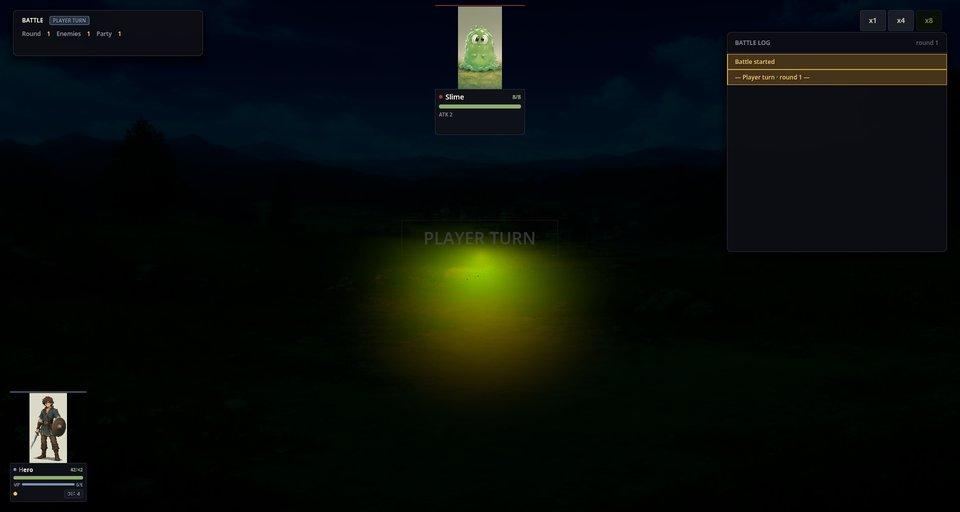

# RPG Demo — маленький мир на тайлах

RPG Demo — короткое законченное приключение на тайлах: деревня у Серого леса, дом старосты и лес, у пещеры которого живёт волк. Вы ходите с клавиатуры, разговариваете с людьми, открываете сундуки, собираете в лесу припасы, продаёте их торговцу и сражаетесь. Мод состоит только из файлов данных и сценариев — ни строчки кода, так что заодно это работающий пример того, как собирается игра на тайловой карте.

У демки нет собственной карточки игры: это мир игры **RPG Plus**, которая включает этот мод и достраивает его поверх. Запуск — **Играть → RPG Plus → Новая игра**: после короткого пролога на перекрёстке вы оказываетесь в этой деревне. Скриншоты ниже сделаны в RPG Plus, поэтому часть людей и товаров в них добавила та игра.


## Как играть

- **Ходить** — WASD или стрелки, **бежать** — Shift.
- **Говорить, открывать, читать** — E или F, стоя лицом к человеку или предмету.
- Шаг на дверной проём или край тропинки переносит на следующую карту.

Сюжет: староста просит прогнать волка, поселившегося у пещеры к востоку от деревни. Мимо пруда, по лесной тропе, разделаться со слизнем, перегородившим путь, и лицом к лицу с волком. Когда волк побеждён, староста благодарит вас — по-своему.

## Что есть в мире

- **Три карты.** Деревня (32×18 тайлов), дом старосты и Серый лес, все нарисованы деревенским тайлсетом из Village Pack.
- **Люди.** Староста выдаёт и закрывает задание, деревенские болтают, табличка называет деревню; одна дверь заперта.
- **Сундуки.** Один в доме старосты, один в лесу; открытые остаются открытыми.
- **Сбор в лесу.** Вдоль троп лежат хворост, камни и лесные грибы; каждое место можно обобрать один раз. Гриб восстанавливает 5 здоровья.
- **Торговец.** Продаёт Эликсир (восстанавливает 20 здоровья) за 10 монет и покупает хворост по 1 монете и камни по 2.
- **Бои.** Слизень на тропе и волк у пещеры видны на карте и вступают в бой, когда вы с ними заговорите. В лесу примерно каждые 48 шагов случаются случайные бои с одним или двумя слизнями.







## Авторам: как это устроено

```filestree
rpg_demo_game/
├── maps/                     rpg_village.json, rpg_elder_house.json, rpg_forest.json
├── map_events/<map>/events.json   люди, двери, сундуки, подбираемые предметы, монстры
├── scenes/                   по одной сцене на карту
├── scenarios/rpg_demo/       вступление, входы на карты и events/*.scenario
├── characters/               герой, слизень и волк
├── items/rpg_demo/           хворост, камни, гриб, эликсир и их значки
├── shops/village_merchant.json
└── locale/                   имена и переводы сценариев на семи языках
```

**Карта** — это сетка номеров тайлов по слоям поверх тайлсета, со своим именем, размером и зумом. Карта леса также перечисляет случайные встречи:

```json
"Encounters": {
  "Steps": 48,
  "Groups": ["rpg_slime", "rpg_slime,rpg_slime"]
}
```

**Событие** — нечто, размещённое на тайле. Дверь с `"Trigger": "Touch"` телепортирует; монстр запускает сценарий и исчезает, когда выставлен его флаг:

```json
{
  "Id": "wolf_boss",
  "X": 25,
  "Y": 8,
  "Sprite": "village/wolf",
  "Dir": "Left",
  "Scenario": "rpg_demo/events/wolf_boss",
  "Condition": "rpg_wolf_dead != 1"
}
```

**Сценарий** произносит строки и начинает бой; победа выставляет флаг:

```scenario
ptext "У пещеры сидит волк. Он оглядывает тебя, как старостину козу." key=rpg_demo/wolf/line1
text "— Р-р-р." key=rpg_demo/wolf/line2
action rpg.battle enemies=rpg_wolf,rpg_slime win_flag=rpg_wolf_dead
end
```

Строки в сценариях этого мода написаны по-русски; у каждой строки есть `key=`, по которому перевод берётся из `locale/scenarios_<lang>.properties`, поэтому игра показывает их на языке интерфейса:

```properties
rpg_demo/wolf/line1 = У пещеры сидит волк. Он оглядывает тебя, как старостину козу.
```

Остальные куски работают так же: сундук выполняет `action item.add`, ставит флаг и заменяется событием открытого сундука с обратным `Condition`; торговец выполняет `action trade.open shop=rpg_demo/village_merchant`; первое посещение деревни запускает вступительный сценарий, который ставит героя в отряд действием `action party.add id=rpg_hero`.

Чтобы менять карты и события наглядно, используйте редактор карт из инструментов RPG-редактора.

## Если что-то пошло не так

1. **Дверь не реагирует.** Дверь `Touch` срабатывает, когда вы на неё наступаете; двери `Action` нужны E или F, стоя к ней лицом.
2. **Монстр или сундук вернулся.** Его `Condition` должен проверять тот же флаг, который выставляет сценарий.
3. **Лавка пуста.** В игре должен быть мод trading, а идентификатор лавки в сценарии должен совпадать с `shops/village_merchant.json`.
